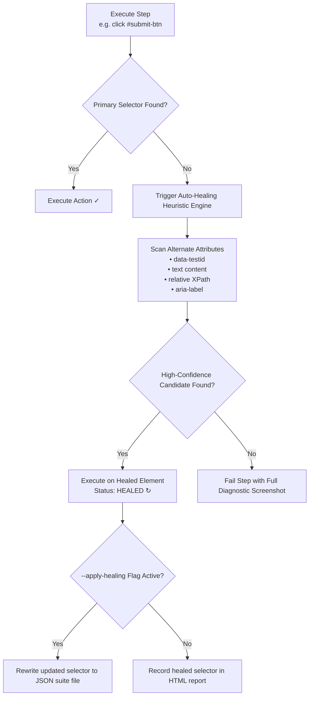

# NextTest Automation Masterclass
## The Complete Hands-On Training Handbook for Modern QA & SDETs
*Authored for QA Engineers, Test Automation Specialists, and Quickitdotnet Academy*  
*Official Training Resource: [https://quickitdotnet.in/](https://quickitdotnet.in/)*

---

## 📖 Book Overview & Curriculum Map

Welcome to the **NextTest Automation Masterclass**. This handbook is designed to take you from initial setup to enterprise-grade test automation, CI/CD pipeline integration, API token chaining, and intelligent locator auto-healing.

### 🎯 What You Will Learn
* **Module 1**: Architecture, Installation & Studio Overview
* **Module 2**: NextTest Suite Anatomy (JSON & Excel Specifications)
* **Module 3**: Web Automation Mastery (Selenium & Playwright Dual Engines)
* **Module 4**: Intelligent Auto-Healing Deep Dive (Zero-Flake Test Execution)
* **Module 5**: REST API Testing & Dynamic Token Chaining
* **Module 6**: Database Workbench & Data-Driven Parameterization
* **Module 7**: Native Desktop & Visual AI Regression Testing
* **Module 8**: Headless Execution & Enterprise CI/CD Pipelines
* **Module 9**: AI-Assisted Test Authoring (Natural Language to JSON)
* **Module 10**: Capstone Project — Automating the CampusFlow Application

---

## 🏛️ Module 1: Architecture, Installation & Studio Overview

### 1.1 What is NextTest?
NextTest is a unified, standalone test automation platform engineered to bridge the gap between low-code ease of use and full-code power. It integrates:
- **Dual Browser Engines**: Choose between **Selenium WebDriver** (maximum cross-browser maturity) and **Playwright** (high-speed modern web execution).
- **Multi-Surface Testing**: Web, REST API, native Windows Desktop, and Visual Regression in one unified suite.
- **Embedded AI & Auto-Healing**: Dynamic heuristic locator recovery that catches broken UI selectors at runtime.
- **Zero-Dependency Portable Binary**: Runs from pre-packaged versioned chunks without requiring node_modules, global package installations, or complex runtime dependencies.

### 1.2 System Requirements
- **Operating System**: Windows 10/11, Windows Server 2016+, Linux (Ubuntu 20.04+), or macOS 12+
- **Java Runtime**: OpenJDK 17 or higher (bundled with standard packaging)
- **Browsers Supported**: Google Chrome, Mozilla Firefox, Microsoft Edge (headless and interactive)

### 1.3 Quick Installation & First Launch
NextTest requires no installation wizard. Simply extract the release package:

```cmd
# 1. Unzip the distribution package
tar -xf nexttest-v1.0.0.zip
cd nexttest-v1.0.0

# 2. Launch the Desktop Studio
bin\NextTest.bat
```
*(On Linux/macOS, execute `./bin/nexttest.sh`)*

### 1.4 Anatomy of NextTest Studio UI
1. **Top Menu Bar**: File management, Scenario recorder, Test runner, Tools, and Help.
2. **Left Explorer**: Test suite tree, test cases, and step list.
3. **Center Canvas**: Interactive step editor, locator builder, and expected outcome configuration.
4. **Bottom Console**: Real-time test execution logs, auto-healing notices, and API traffic inspect window.
5. **Right Inspector**: Live DOM inspector, selector suggestions, and visual screenshot evidence.

---

## 📄 Module 2: NextTest Suite Anatomy (JSON & Excel Specifications)

Every test in NextTest is described by a transparent, portable data structure. Suites can be created either as structured **JSON** files or standard **Microsoft Excel (.xlsx)** workbooks.

### 2.1 JSON Suite Structure
A NextTest suite consists of metadata, shared suite data, and an array of test cases containing sequential steps:

```json
{
  "name": "User Authentication & Dashboard Smoke Suite",
  "platform": "WEB",
  "engine": "SELENIUM",
  "data": {
    "baseUrl": "http://127.0.0.1:3100",
    "adminUser": "admin@quickitdotnet.in",
    "timeout": "10"
  },
  "testCases": [
    {
      "testCaseId": "AUTH-001",
      "Case": "Successful Admin Login",
      "isRun": true,
      "hardStop": true,
      "testSteps": [
        {
          "steps": "Open browser and navigate to home page",
          "action": "openBrowserChrome",
          "value": "${baseUrl}",
          "isRun": true
        },
        {
          "steps": "Input admin username",
          "action": "type",
          "locator": "id",
          "locatorValue": "username",
          "value": "${adminUser}",
          "isRun": true
        },
        {
          "steps": "Input admin password",
          "action": "type",
          "locator": "id",
          "locatorValue": "password",
          "value": "Admin@123",
          "isRun": true
        },
        {
          "steps": "Click submit button",
          "action": "click",
          "locator": "xpath",
          "locatorValue": "//button[@type='submit']",
          "isRun": true
        },
        {
          "steps": "Verify welcome header appears",
          "action": "validateText",
          "locator": "css",
          "locatorValue": ".welcome-banner h1",
          "value": "Dashboard Overview",
          "isRun": true
        }
      ]
    }
  ]
}
```

### 2.2 Key Properties Explained
* `isRun` (`boolean`): Toggle execution of an entire test case or individual step without deleting code.
* `hardStop` (`boolean`): If `true`, a failure in this test case aborts the entire suite (ideal for authentication prerequisites).
* `locator`: Supported locator strategies (`id`, `name`, `xpath`, `css`, `linkText`, `partialLinkText`, `className`, `tagName`).
* `value`: The parameter or input payload delivered to the action. Can reference data variables using `${variableName}`.

---

## 🌐 Module 3: Web Automation Mastery

NextTest includes over 200 built-in automation commands covering all modern web interaction patterns.

### 3.1 Common Web Actions Reference Table

| Action Name | Description | Locator Required? | `value` Example |
| :--- | :--- | :---: | :--- |
| `openBrowserChrome` | Launches Google Chrome to specified URL | No | `https://app.example.com` |
| `openBrowserFirefox`| Launches Mozilla Firefox to specified URL | No | `https://app.example.com` |
| `openBrowserEdge`   | Launches Microsoft Edge to specified URL | No | `https://app.example.com` |
| `click` | Standard click with automatic element scroll into view | Yes | N/A |
| `jclick` | JavaScript-forced direct DOM click (bypasses overlays) | Yes | N/A |
| `type` | Clears field and enters keystrokes | Yes | `John Doe` |
| `typeAppend` | Types text without clearing existing field contents | Yes | ` - Verified` |
| `selectDropDown` | Selects option in `<select>` by visible text | Yes | `California` |
| `selectDropDownValue`| Selects option in `<select>` by value attribute | Yes | `CA` |
| `mouseHover` | Hovers mouse pointer over element to reveal dropdowns | Yes | N/A |
| `switchTab` | Switches active focus to browser tab by index (0, 1, 2) | No | `1` |
| `switchToIFrame` | Focuses driver inside nested `<iframe>` | Yes | N/A |
| `switchToDefaultFrame`| Returns focus from iframe back to parent DOM | No | N/A |
| `acceptAlert` | Clicks 'OK' on native browser alert dialog | No | N/A |
| `validateText` | Asserts element contains expected string | Yes | `Order Confirmed` |
| `validateTitle` | Asserts browser window title matches string | No | `Home | Quickitdotnet` |
| `takeScreenshot` | Captures full page visual proof to report directory | No | `checkout-step.png` |

---

## ⚡ Module 4: Intelligent Auto-Healing Deep Dive

### 4.1 Why Tests Break (The Flakiness Problem)
In modern single-page applications (React, Angular, Vue, Next.js), UI elements frequently change due to:
* Dynamic CSS-in-JS classes (e.g. `class="btn-sc-1j2k3"` changes every build).
* Redesigned DOM hierarchies (extra `<div>` containers wrap buttons).
* Replaced IDs and accessibility attributes.

In traditional tools, a changed ID results in `NoSuchElementException`, failing nightly CI pipelines and wasting hours of developer time.

### 4.2 How NextTest Auto-Healing Works
When a step's primary locator fails, NextTest does **not** fail immediately:
1. **Fallback Heuristic Analysis**: It dynamically searches the DOM for candidate elements matching secondary attributes (test IDs, name, ARIA labels, text content, relative position).
2. **Confidence Scoring**: It matches the element with the highest similarity score.
3. **Execution Recovery**: It performs the user action on the healed element, flags the test run as `HEALED`, and logs visual proof.
4. **Self-Updating Suites**: When invoked with `--apply-healing`, NextTest automatically updates your JSON suite files with the repaired locator.



### 4.3 CLI Commands for Auto-Healing
```cmd
# Run tests with auto-healing logging:
bin\NextTest.bat --suite "scenarios\checkout.json" --headless --self-healing

# Run tests and automatically save healed locators back to disk:
bin\NextTest.bat --suite "scenarios\checkout.json" --headless --self-healing --apply-healing
```

---

## 🔌 Module 5: REST API Testing & Dynamic Token Chaining

NextTest natively tests backend APIs without needing external tools like Postman.

### 5.1 API Action Structure
For API steps:
* `action`: `api-GET`, `api-POST`, `api-PUT`, `api-DELETE`
* `value`: The target URL or endpoint route (e.g., `/api/v1/students`)
* `actualValue`: A JSON configuration string containing `BaseUrl`, `Headers`, and `Payload`.

### 5.2 Hands-On Exercise: Token Chaining
In modern microservices, you authenticate first, receive a JWT Bearer token, and pass that token into subsequent requests.

#### Step 1: Login Request (Capturing the Token)
```json
{
  "steps": "Authenticate Admin User",
  "action": "api-POST",
  "value": "/api/auth/login",
  "actualValue": "{\"BaseUrl\":\"http://127.0.0.1:3100\",\"Headers\":{\"Content-Type\":\"application/json\"},\"Payload\":{\"email\":\"admin@quickitdotnet.in\",\"password\":\"Admin@123\"}}",
  "isRun": true
}
```

#### Step 2: Extracting Token into Data Dictionary
NextTest extracts the JSON response field `token` and stores it into the suite variable `{{authToken}}`.

#### Step 3: Using Token in Protected API Call
```json
{
  "steps": "Fetch Student Directory with Bearer Token",
  "action": "api-GET",
  "value": "/api/students",
  "actualValue": "{\"BaseUrl\":\"http://127.0.0.1:3100\",\"Headers\":{\"Authorization\":\"Bearer {{authToken}}\",\"Content-Type\":\"application/json\"}}",
  "isRun": true
}
```

---

## 🗄️ Module 6: Database Workbench & Parameterization

### 6.1 Database Verification (JDBC Workbench)
NextTest includes built-in JDBC connectors for:
* **PostgreSQL** (`jdbc:postgresql://host:port/database`)
* **MySQL** (`jdbc:mysql://host:port/database`)
* **Microsoft SQL Server** (`jdbc:sqlserver://host:port;databaseName=db`)
* **Oracle DB** (`jdbc:oracle:thin:@host:port:SID`)
* **SQLite** (`jdbc:sqlite:filepath.db`)
* **MongoDB** (`mongodb://host:port/database`)

### 6.2 Data-Driven Testing via Excel
Loop through hundreds of customer rows using a single test scenario:
1. Link an Excel spreadsheet in suite `data`: `"dataFile": "data/students.xlsx"`.
2. Reference column names directly in your steps: `${studentName}`, `${email}`, `${course}`.
3. NextTest executes the test case iteratively for every row in the spreadsheet.

---

## 🖥️ Module 7: Native Desktop & Visual AI Regression Testing

### 7.1 Native Windows Application Automation
NextTest automates native desktop software (WPF, Win32, WinForms, Electron):
* Launch desktop executables: `openDesktopApp` with path `C:\Program Files\App\app.exe`.
* Inspect and interact with controls using UIAutomation IDs and Accessibility properties.

### 7.2 Visual Baseline Testing
Ensure visual pixels haven't shifted between releases:
* Action `validateVisualSnapshot`: Compares the live rendered viewport against a master baseline PNG image.
* Highlights layout shifts, font changes, and color regressions in red-line diff reports.

---

## 🚀 Module 8: Headless Execution & Enterprise CI/CD Pipelines

### 8.1 Headless CLI Execution
Run NextTest from PowerShell, Bash, or CI task runners without opening GUI windows:

```cmd
bin\NextTest.bat --suite "scenarios\regression.json" --headless --browser chrome --output-dir "target\reports" --report-formats html,junit
```

### 8.2 GitHub Actions Pipeline Template (`.github/workflows/nexttest.yml`)
```yaml
name: NextTest Automation Pipeline

on:
  push:
    branches: [ main ]
  pull_request:
    branches: [ main ]

jobs:
  test:
    runs-on: windows-latest

    steps:
    - uses: actions/checkout@v4

    - name: Set up OpenJDK 17
      uses: actions/setup-java@v4
      with:
        java-version: '17'
        distribution: 'temurin'

    - name: Run NextTest Headless Regression
      run: |
        .\bin\NextTest.bat --run .\scenarios\regression.json --headless --self-healing --output-dir .\reports

    - name: Publish Test Report Artifacts
      uses: actions/upload-artifact@v4
      if: always()
      with:
        name: nexttest-html-report
        path: .\reports
```

---

## 🤖 Module 9: AI-Assisted Test Authoring

NextTest features grounded AI authoring using the bundled action specifications in `COMMANDS.md`.

### 9.1 Prompting AI to Generate Suites
You can use any modern LLM (ChatGPT, Claude, Gemini, or local models) to generate ready-to-run NextTest JSON suites:

**Prompt Example**:
> *"You are a NextTest test author. Based on the NextTest JSON schema in COMMANDS.md, generate a complete test suite for testing a student registration form at http://127.0.0.1:3100. Include steps to open Chrome, enter student name, select gender, pick course from dropdown, submit form, and validate success alert."*

The model will output a validated NextTest JSON suite matching exact action verbs (`openBrowserChrome`, `type`, `selectDropDown`, `click`, `validateText`).

---

## 🎓 Module 10: Capstone Project — Automating CampusFlow

To complete your training, automate the bundled sample application **CampusFlow**:

### Capstone Objectives:
1. **Start Application**: Launch `sample-application` on `http://127.0.0.1:3100`.
2. **Scenario 1 (UI)**: Automate Admin login and verify dashboard statistics.
3. **Scenario 2 (Data-Driven)**: Register 5 new students from an Excel data sheet.
4. **Scenario 3 (Auto-Healing)**: Intentionally alter an element ID in the HTML and observe NextTest heal the locator without failing.
5. **Scenario 4 (API Verification)**: Issue an `api-GET` to `/api/students` and assert that the newly added students exist in the JSON response.
6. **Scenario 5 (Reporting)**: Generate a combined executive HTML report and review execution metrics.

---

## 📞 Support, Academy Training & Automation-as-a-Service

Want personalized training, live mentor-led workshops, or end-to-end automation built for your company?

* **Academy & Training**: [https://quickitdotnet.in/](https://quickitdotnet.in/)
* **Inquiries & Automation-as-a-Service**: `NextTest@quickitdotnet.in`
* **Direct Support Line**: `+91 8652457999`
* **GitHub Repository**: [https://github.com/NextTestDeployment/nextTest](https://github.com/NextTestDeployment/nextTest)

*© 2026 NextTest Automation. Developed in partnership with Quickitdotnet. 100% Free & Open Community Edition.*
